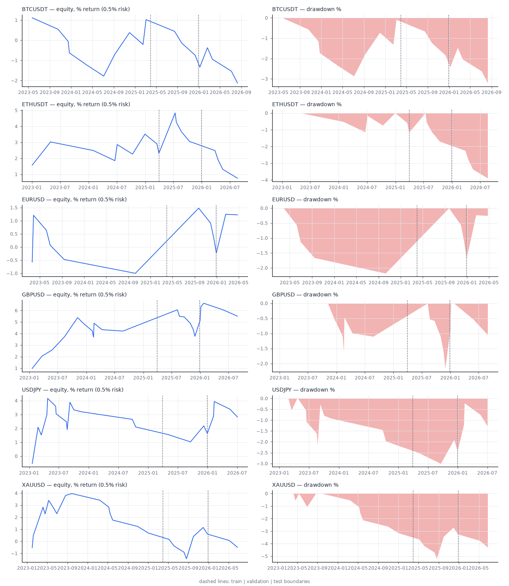
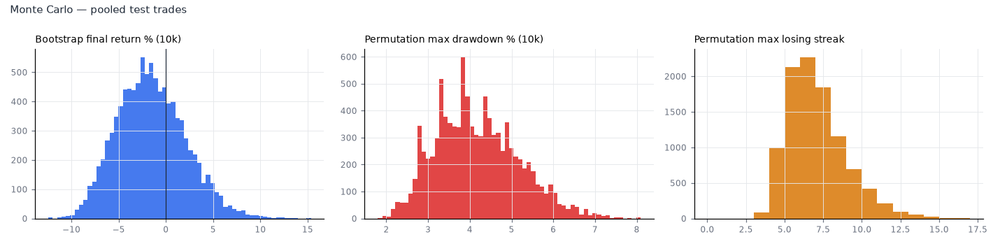
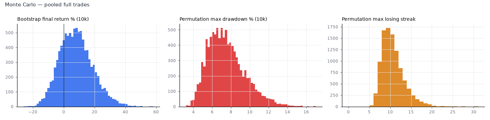

# Liquidity + Structure + Displacement + OB + FVG + Fib Confluence — Backtest Report

> **⚠ SYNTHETIC NULL DATA — NOT MARKET RESULTS.** Every number below comes from a driftless random walk (GARCH volatility clustering, t(4) fat tails, intraday seasonality, FX weekend gaps) generated by `lcs/data.py`. By construction it contains **no exploitable edge**. This run exists to (1) exercise the entire pipeline end-to-end and (2) confirm the engine does not manufacture profits from look-ahead. **It says nothing about BTCUSDT, ETHUSDT, EURUSD, GBPUSD, USDJPY or XAUUSD.** Real data could not be downloaded from this environment (network policy blocks data.binance.vision and datafeed.dukascopy.com). Run `python run_backtest.py` after `python download_data.py` to produce the real report.

Generated in 5.9 min. Splits: **train** 2023-01-01 -> 2025-03-30, **validation** 2025-03-30 -> 2025-12-28, **test** 2025-12-28 -> 2026-09-28, **full** 2023-01-01 -> 2026-09-28

News calendar: built-in FOMC (exact) + NFP (first-Friday approximation).

## 1. Executive summary

* Final configuration (chosen on training data, confirmed on validation): `disp body>=0.50 range>=1.00xATR; SLbuf=0.50xATR; minScore=8; entry=limit; exit=tp2; session=london_ny`

* **Out-of-sample (test) result, realistic costs: unprofitable** — 24 trades, expectancy -0.127 R, PF 0.83, win rate 29.2%, net -3.0 R, max DD 7.02%, p-value 0.654.

* In-sample (train): 65 trades, expectancy 0.292 R, PF 1.44.

* Cost sensitivity (test): zero-cost -0.015 R → realistic -0.127 R → adverse -0.066 R per trade.

* Walk-forward: 9 out-of-sample windows, 44% with positive net R; concatenated WF expectancy -0.145 R over 157 trades.

* Parameter sensitivity: FRAGILE (sign of full-sample expectancy flips under a one-step perturbation).

* **Final classification (pooled): No evidence** — on synthetic null data this is the expected answer and validates the engine, it is NOT a verdict on the real markets.

## 2. Final mechanical rules (frozen)

Full specification: `STRATEGY_SPEC.md`. Tuned values (training data only):

| parameter | value |
|---|---|
| disp_body | 0.50 |
| disp_atr | 1.00 |
| disp_close_pct | 0.20 |
| sl_buffer_atr | 0.50 |
| min_score | 8 |
| entry_mode | limit |
| exit_mode | tp2 |
| session | london_ny |
| model | both |
| swing_n_15m | 2 |
| swing_n_1h | 3 |
| swing_n_4h | 2 |
| fib_lo | 0.62 |
| fib_hi | 0.79 |
| min_rr_to_tp2 | 2.00 |
| max_cost_r | 0.25 |
| daily_loss_limit_r | 2.00 |
| risk_pct | 0.50 |

### Parameter selection audit trail

Stage 1 (train, top 10 of 36):

| t | n | exp | cfg |
|---|---|---|---|
| 0.580 | 155 | 0.068 | disp body>=0.50 range>=1.00xATR; SLbuf=0.50xATR; minScore=8; entry=limit; exit=rr2.0; session=all |
| 0.050 | 141 | 0.006 | disp body>=0.60 range>=1.20xATR; SLbuf=0.50xATR; minScore=8; entry=limit; exit=rr2.0; session=all |
| -0.022 | 128 | -0.003 | disp body>=0.70 range>=1.50xATR; SLbuf=0.50xATR; minScore=8; entry=limit; exit=rr2.0; session=all |
| -0.321 | 292 | -0.027 | disp body>=0.50 range>=1.00xATR; SLbuf=0.50xATR; minScore=7; entry=limit; exit=rr2.0; session=all |
| -0.367 | 158 | -0.042 | disp body>=0.50 range>=1.00xATR; SLbuf=0.25xATR; minScore=8; entry=limit; exit=rr2.0; session=all |
| -0.592 | 133 | -0.074 | disp body>=0.70 range>=1.50xATR; SLbuf=0.25xATR; minScore=8; entry=limit; exit=rr2.0; session=all |
| -0.676 | 146 | -0.080 | disp body>=0.60 range>=1.20xATR; SLbuf=0.25xATR; minScore=8; entry=limit; exit=rr2.0; session=all |
| -0.918 | 164 | -0.103 | disp body>=0.50 range>=1.00xATR; SLbuf=0.10xATR; minScore=8; entry=limit; exit=rr2.0; session=all |
| -0.982 | 236 | -0.091 | disp body>=0.70 range>=1.50xATR; SLbuf=0.50xATR; minScore=7; entry=limit; exit=rr2.0; session=all |
| -1.001 | 154 | -0.115 | disp body>=0.60 range>=1.20xATR; SLbuf=0.10xATR; minScore=8; entry=limit; exit=rr2.0; session=all |

Stage 2 (train, top 10 of 64):

| t | n | exp | cfg |
|---|---|---|---|
| 2.014 | 65 | 0.432 | disp body>=0.50 range>=1.00xATR; SLbuf=0.50xATR; minScore=8; entry=limit; exit=rr2.5; session=london_ny |
| 1.967 | 65 | 0.403 | disp body>=0.50 range>=1.00xATR; SLbuf=0.50xATR; minScore=8; entry=limit; exit=trail; session=london_ny |
| 1.958 | 65 | 0.364 | disp body>=0.50 range>=1.00xATR; SLbuf=0.50xATR; minScore=8; entry=limit; exit=rr2.0; session=london_ny |
| 1.484 | 65 | 0.349 | disp body>=0.50 range>=1.00xATR; SLbuf=0.50xATR; minScore=8; entry=limit; exit=rr3.0; session=london_ny |
| 1.244 | 65 | 0.292 | disp body>=0.50 range>=1.00xATR; SLbuf=0.50xATR; minScore=8; entry=limit; exit=tp2; session=london_ny |
| 1.231 | 65 | 0.218 | disp body>=0.50 range>=1.00xATR; SLbuf=0.50xATR; minScore=8; entry=limit; exit=partial; session=london_ny |
| 1.141 | 65 | 0.178 | disp body>=0.50 range>=1.00xATR; SLbuf=0.50xATR; minScore=8; entry=limit; exit=rr1.5; session=london_ny |
| 1.006 | 65 | 0.271 | disp body>=0.50 range>=1.00xATR; SLbuf=0.50xATR; minScore=8; entry=limit; exit=rr4.0; session=london_ny |
| 0.580 | 155 | 0.068 | disp body>=0.50 range>=1.00xATR; SLbuf=0.50xATR; minScore=8; entry=limit; exit=rr2.0; session=all |
| 0.385 | 154 | 0.046 | disp body>=0.50 range>=1.00xATR; SLbuf=0.50xATR; minScore=8; entry=limit; exit=trail; session=all |

Validation check of the 5 best training configs (the first row was frozen):

| val_t | val_n | val_exp | train_t | train_n | train_exp | cfg |
|---|---|---|---|---|---|---|
| -0.003 | 26 | -0.001 | 1.244 | 65 | 0.292 | disp body>=0.50 range>=1.00xATR; SLbuf=0.50xATR; minScore=8; entry=limit; exit=tp2; session=london_ny |
| -0.507 | 26 | -0.162 | 1.967 | 65 | 0.403 | disp body>=0.50 range>=1.00xATR; SLbuf=0.50xATR; minScore=8; entry=limit; exit=trail; session=london_ny |
| -0.994 | 26 | -0.283 | 2.014 | 65 | 0.432 | disp body>=0.50 range>=1.00xATR; SLbuf=0.50xATR; minScore=8; entry=limit; exit=rr2.5; session=london_ny |
| -1.146 | 26 | -0.342 | 1.484 | 65 | 0.349 | disp body>=0.50 range>=1.00xATR; SLbuf=0.50xATR; minScore=8; entry=limit; exit=rr3.0; session=london_ny |
| -1.526 | 26 | -0.379 | 1.958 | 65 | 0.364 | disp body>=0.50 range>=1.00xATR; SLbuf=0.50xATR; minScore=8; entry=limit; exit=rr2.0; session=london_ny |

## 3. Data

| market | start | end | bars | ohlc_inconsistent_bars | unexpected_gaps | largest_gap | zero_range_bars_pct |
|---|---|---|---|---|---|---|---|
| BTCUSDT | 2023-01-01 00:00:00+00:00 | 2026-09-27 23:55:00+00:00 | 393408 | 0 | 0 | none | 0.00 |
| ETHUSDT | 2023-01-01 00:00:00+00:00 | 2026-09-27 23:55:00+00:00 | 393408 | 0 | 0 | none | 0.00 |
| EURUSD | 2023-01-01 21:00:00+00:00 | 2026-09-27 23:55:00+00:00 | 280836 | 0 | 0 | none | 0.00 |
| GBPUSD | 2023-01-01 21:00:00+00:00 | 2026-09-27 23:55:00+00:00 | 280836 | 0 | 0 | none | 0.00 |
| USDJPY | 2023-01-01 21:00:00+00:00 | 2026-09-27 23:55:00+00:00 | 280836 | 0 | 0 | none | 0.00 |
| XAUUSD | 2023-01-01 21:00:00+00:00 | 2026-09-27 23:55:00+00:00 | 280836 | 0 | 0 | none | 0.00 |

## 4. Performance by market (realistic costs)

Train and validation are in-sample for selection purposes; **test is the only untouched period**.

### BTCUSDT

| metric | train | validation | TEST (OOS) | full |
|---|---|---|---|---|
| Total trades | 10.000 | 3.000 | 5.000 | 18.000 |
| Winners | 4.000 | 0.000 | 1.000 | 5.000 |
| Losers | 6.000 | 3.000 | 4.000 | 13.000 |
| Win rate % | 40.000 | 0.000 | 20.000 | 27.778 |
| Average win (R) | 2.270 | 0.000 | 1.952 | 2.207 |
| Average loss (R) | 1.162 | 1.173 | 1.184 | 1.171 |
| Reward/risk | 1.954 | 0.000 | 1.648 | 1.884 |
| Expectancy (R/trade) | 0.211 | -1.173 | -0.557 | -0.233 |
| Expectancy 95% CI low | -0.821 | -1.210 | -1.196 | -0.820 |
| Expectancy 95% CI high | 1.268 | -1.150 | 0.701 | 0.511 |
| p-value (mean R > 0) | 0.358 | 1.000 | 0.788 | 0.733 |
| Profit factor | 1.303 | 0.000 | 0.412 | 0.725 |
| Net R | 2.111 | -3.519 | -2.786 | -4.194 |
| Net return % (0.5% risk) | 1.025 | -1.749 | -1.395 | -2.127 |
| CAGR % | 0.456 | -2.333 | -1.855 | -0.573 |
| Max drawdown % | 2.862 | 1.749 | 1.762 | 3.204 |
| Max drawdown (R) | 5.790 | 3.519 | 3.545 | 6.420 |
| Max DD duration (days) | 528.417 | 135.201 | 192.549 | 1075.417 |
| Sharpe (daily, √365) | – | – | – | – |
| Sortino | – | – | – | – |
| Calmar | 0.159 | -1.334 | -1.053 | -0.179 |
| Recovery factor | 0.358 | -1.000 | -0.792 | -0.664 |
| Max consecutive losses | 5.000 | 3.000 | 3.000 | 5.000 |
| Max consecutive wins | 2.000 | 0.000 | 1.000 | 2.000 |
| Avg cost per trade (R) | 0.110 | 0.142 | 0.132 | 0.121 |

### ETHUSDT

| metric | train | validation | TEST (OOS) | full |
|---|---|---|---|---|
| Total trades | 9.000 | 4.000 | 4.000 | 17.000 |
| Winners | 4.000 | 1.000 | 0.000 | 5.000 |
| Losers | 5.000 | 3.000 | 4.000 | 12.000 |
| Win rate % | 44.444 | 25.000 | 0.000 | 29.412 |
| Average win (R) | 2.607 | 4.927 | 0.000 | 3.071 |
| Average loss (R) | 1.153 | 1.139 | 1.124 | 1.140 |
| Reward/risk | 2.261 | 4.327 | 0.000 | 2.694 |
| Expectancy (R/trade) | 0.518 | 0.378 | -1.124 | 0.099 |
| Expectancy 95% CI low | -0.706 | -1.154 | -1.149 | -0.733 |
| Expectancy 95% CI high | 1.783 | 3.412 | -1.100 | 1.116 |
| p-value (mean R > 0) | 0.230 | 0.410 | 1.000 | 0.423 |
| Profit factor | 1.809 | 1.442 | 0.000 | 1.123 |
| Net R | 4.665 | 1.511 | -4.498 | 1.678 |
| Net return % (0.5% risk) | 2.316 | 0.723 | -2.230 | 0.758 |
| CAGR % | 1.026 | 0.969 | -2.962 | 0.202 |
| Max drawdown % | 1.156 | 1.698 | 2.230 | 3.891 |
| Max drawdown (R) | 2.318 | 3.416 | 4.498 | 7.914 |
| Max DD duration (days) | 333.125 | 160.368 | 185.420 | 434.368 |
| Sharpe (daily, √365) | – | – | – | – |
| Sortino | – | – | – | – |
| Calmar | 0.888 | 0.570 | -1.328 | 0.052 |
| Recovery factor | 2.004 | 0.426 | -1.000 | 0.195 |
| Max consecutive losses | 2.000 | 3.000 | 4.000 | 7.000 |
| Max consecutive wins | 2.000 | 1.000 | 0.000 | 2.000 |
| Avg cost per trade (R) | 0.090 | 0.094 | 0.093 | 0.091 |

### EURUSD

| metric | train | validation | TEST (OOS) | full |
|---|---|---|---|---|
| Total trades | 6.000 | 3.000 | 3.000 | 12.000 |
| Winners | 1.000 | 1.000 | 1.000 | 3.000 |
| Losers | 5.000 | 2.000 | 2.000 | 9.000 |
| Win rate % | 16.667 | 33.333 | 33.333 | 25.000 |
| Average win (R) | 3.583 | 5.015 | 2.947 | 3.848 |
| Average loss (R) | 1.110 | 1.128 | 0.583 | 0.997 |
| Reward/risk | 3.228 | 4.447 | 5.055 | 3.861 |
| Expectancy (R/trade) | -0.328 | 0.920 | 0.594 | 0.214 |
| Expectancy 95% CI low | -1.129 | -1.134 | -1.122 | -0.928 |
| Expectancy 95% CI high | 1.242 | 5.015 | 2.947 | 1.564 |
| p-value (mean R > 0) | 0.654 | 0.349 | 0.337 | 0.374 |
| Profit factor | 0.646 | 2.223 | 2.528 | 1.287 |
| Net R | -1.967 | 2.759 | 1.781 | 2.573 |
| Net return % (0.5% risk) | -1.002 | 1.355 | 0.882 | 1.224 |
| CAGR % | -0.448 | 1.816 | 1.177 | 0.326 |
| Max drawdown % | 2.182 | 1.125 | 0.561 | 2.182 |
| Max drawdown (R) | 4.401 | 2.255 | 1.122 | 4.401 |
| Max DD duration (days) | 661.594 | 30.146 | 156.125 | 839.069 |
| Sharpe (daily, √365) | – | – | – | – |
| Sortino | – | – | – | – |
| Calmar | -0.205 | 1.615 | 2.099 | 0.149 |
| Recovery factor | -0.459 | 1.204 | 1.572 | 0.561 |
| Max consecutive losses | 4.000 | 2.000 | 1.000 | 4.000 |
| Max consecutive wins | 1.000 | 1.000 | 1.000 | 1.000 |
| Avg cost per trade (R) | 0.085 | 0.085 | 0.085 | 0.085 |

### GBPUSD

| metric | train | validation | TEST (OOS) | full |
|---|---|---|---|---|
| Total trades | 11.000 | 6.000 | 5.000 | 22.000 |
| Winners | 6.000 | 1.000 | 3.000 | 10.000 |
| Losers | 5.000 | 5.000 | 2.000 | 12.000 |
| Win rate % | 54.545 | 16.667 | 60.000 | 45.455 |
| Average win (R) | 2.145 | 3.530 | 1.824 | 2.187 |
| Average loss (R) | 0.904 | 0.873 | 1.050 | 0.915 |
| Reward/risk | 2.372 | 4.046 | 1.737 | 2.389 |
| Expectancy (R/trade) | 0.759 | -0.139 | 0.674 | 0.495 |
| Expectancy 95% CI low | -0.157 | -1.072 | -0.722 | -0.175 |
| Expectancy 95% CI high | 1.705 | 1.391 | 2.076 | 1.219 |
| p-value (mean R > 0) | 0.083 | 0.570 | 0.220 | 0.094 |
| Profit factor | 2.846 | 0.809 | 2.606 | 1.991 |
| Net R | 8.347 | -0.832 | 3.372 | 10.887 |
| Net return % (0.5% risk) | 4.217 | -0.436 | 1.682 | 5.507 |
| CAGR % | 1.859 | -0.583 | 2.248 | 1.444 |
| Max drawdown % | 1.608 | 2.163 | 1.047 | 2.163 |
| Max drawdown (R) | 3.233 | 4.363 | 2.099 | 4.363 |
| Max DD duration (days) | 467.483 | 128.569 | 123.368 | 597.997 |
| Sharpe (daily, √365) | – | – | – | – |
| Sortino | – | – | – | – |
| Calmar | 1.157 | -0.270 | 2.147 | 0.667 |
| Recovery factor | 2.623 | -0.202 | 1.606 | 2.546 |
| Max consecutive losses | 3.000 | 5.000 | 2.000 | 5.000 |
| Max consecutive wins | 5.000 | 1.000 | 3.000 | 5.000 |
| Avg cost per trade (R) | 0.054 | 0.059 | 0.053 | 0.055 |

### USDJPY

| metric | train | validation | TEST (OOS) | full |
|---|---|---|---|---|
| Total trades | 14.000 | 3.000 | 5.000 | 22.000 |
| Winners | 4.000 | 1.000 | 2.000 | 7.000 |
| Losers | 10.000 | 2.000 | 3.000 | 15.000 |
| Win rate % | 28.571 | 33.333 | 40.000 | 31.818 |
| Average win (R) | 3.571 | 2.274 | 2.246 | 3.007 |
| Average loss (R) | 0.997 | 1.052 | 1.072 | 1.019 |
| Reward/risk | 3.584 | 2.162 | 2.095 | 2.951 |
| Expectancy (R/trade) | 0.309 | 0.057 | 0.255 | 0.262 |
| Expectancy 95% CI low | -0.735 | -1.057 | -1.075 | -0.519 |
| Expectancy 95% CI high | 1.537 | 2.274 | 1.672 | 1.113 |
| p-value (mean R > 0) | 0.308 | 0.482 | 0.385 | 0.275 |
| Profit factor | 1.434 | 1.081 | 1.397 | 1.377 |
| Net R | 4.320 | 0.171 | 1.276 | 5.767 |
| Net return % (0.5% risk) | 2.099 | 0.076 | 0.623 | 2.814 |
| CAGR % | 0.931 | 0.102 | 0.831 | 0.745 |
| Max drawdown % | 2.159 | 1.049 | 1.074 | 3.004 |
| Max drawdown (R) | 4.353 | 2.104 | 2.153 | 6.036 |
| Max DD duration (days) | 656.302 | 220.802 | 132.358 | 1203.302 |
| Sharpe (daily, √365) | – | – | – | – |
| Sortino | – | – | – | – |
| Calmar | 0.431 | 0.097 | 0.774 | 0.248 |
| Recovery factor | 0.972 | 0.073 | 0.580 | 0.937 |
| Max consecutive losses | 4.000 | 2.000 | 2.000 | 6.000 |
| Max consecutive wins | 2.000 | 1.000 | 2.000 | 2.000 |
| Avg cost per trade (R) | 0.060 | 0.047 | 0.060 | 0.059 |

### XAUUSD

| metric | train | validation | TEST (OOS) | full |
|---|---|---|---|---|
| Total trades | 15.000 | 7.000 | 2.000 | 24.000 |
| Winners | 5.000 | 2.000 | 0.000 | 7.000 |
| Losers | 10.000 | 5.000 | 2.000 | 17.000 |
| Win rate % | 33.333 | 28.571 | 0.000 | 29.167 |
| Average win (R) | 2.431 | 2.617 | 0.000 | 2.484 |
| Average loss (R) | 1.066 | 1.071 | 1.093 | 1.071 |
| Reward/risk | 2.280 | 2.444 | 0.000 | 2.321 |
| Expectancy (R/trade) | 0.100 | -0.017 | -1.093 | -0.034 |
| Expectancy 95% CI low | -0.765 | -1.075 | -1.118 | -0.671 |
| Expectancy 95% CI high | 1.099 | 1.405 | -1.067 | 0.744 |
| p-value (mean R > 0) | 0.421 | 0.509 | – | 0.536 |
| Profit factor | 1.140 | 0.978 | 0.000 | 0.956 |
| Net R | 1.495 | -0.119 | -2.185 | -0.810 |
| Net return % (0.5% risk) | 0.687 | -0.087 | -1.090 | -0.497 |
| CAGR % | 0.306 | -0.116 | -1.450 | -0.133 |
| Max drawdown % | 3.151 | 2.117 | 1.090 | 5.201 |
| Max drawdown (R) | 6.386 | 4.268 | 2.185 | 10.654 |
| Max DD duration (days) | 380.493 | 206.337 | 145.240 | 927.493 |
| Sharpe (daily, √365) | – | – | – | – |
| Sortino | – | – | – | – |
| Calmar | 0.097 | -0.055 | -1.331 | -0.026 |
| Recovery factor | 0.218 | -0.041 | -1.000 | -0.096 |
| Max consecutive losses | 6.000 | 4.000 | 2.000 | 10.000 |
| Max consecutive wins | 2.000 | 2.000 | 0.000 | 2.000 |
| Avg cost per trade (R) | 0.038 | 0.039 | 0.049 | 0.039 |

### POOLED

| metric | train | validation | TEST (OOS) | full |
|---|---|---|---|---|
| Total trades | 65.000 | 26.000 | 24.000 | 115.000 |
| Winners | 24.000 | 6.000 | 7.000 | 37.000 |
| Losers | 41.000 | 20.000 | 17.000 | 78.000 |
| Win rate % | 36.923 | 23.077 | 29.167 | 32.174 |
| Average win (R) | 2.600 | 3.497 | 2.123 | 2.655 |
| Average loss (R) | 1.059 | 1.050 | 1.053 | 1.056 |
| Reward/risk | 2.455 | 3.329 | 2.016 | 2.515 |
| Expectancy (R/trade) | 0.292 | -0.001 | -0.127 | 0.138 |
| Expectancy 95% CI low | -0.165 | -0.710 | -0.669 | -0.168 |
| Expectancy 95% CI high | 0.769 | 0.796 | 0.476 | 0.488 |
| p-value (mean R > 0) | 0.109 | 0.501 | 0.654 | 0.213 |
| Profit factor | 1.437 | 0.999 | 0.830 | 1.193 |
| Net R | 18.971 | -0.030 | -3.040 | 15.901 |
| Net return % (0.5% risk) | 9.631 | -0.147 | -1.576 | 7.744 |
| CAGR % | 4.191 | -0.225 | -2.360 | 2.062 |
| Max drawdown % | 7.205 | 2.750 | 7.024 | 7.678 |
| Max drawdown (R) | 14.863 | 5.561 | 14.525 | 15.543 |
| Max DD duration (days) | 498.125 | 72.590 | 162.549 | 1015.125 |
| Sharpe (daily, √365) | – | – | – | – |
| Sortino | – | – | – | – |
| Calmar | 0.582 | -0.082 | -0.336 | 0.269 |
| Recovery factor | 1.337 | -0.053 | -0.224 | 1.009 |
| Max consecutive losses | 7.000 | 6.000 | 14.000 | 14.000 |
| Max consecutive wins | 5.000 | 2.000 | 5.000 | 5.000 |
| Avg cost per trade (R) | 0.068 | 0.070 | 0.081 | 0.071 |

### Market comparison (test split, realistic costs)

| market | trades | win_rate | expectancy_R | profit_factor | net_R | max_dd_pct | p_value | classification |
|---|---|---|---|---|---|---|---|---|
| BTCUSDT | 5 | 20.000 | -0.557 | 0.412 | -2.786 | 1.762 | 0.788 | No evidence |
| ETHUSDT | 4 | 0.000 | -1.124 | 0.000 | -4.498 | 2.230 | 1.000 | No evidence |
| EURUSD | 3 | 33.333 | 0.594 | 2.528 | 1.781 | 0.561 | 0.337 | No evidence |
| GBPUSD | 5 | 60.000 | 0.674 | 2.606 | 3.372 | 1.047 | 0.220 | No evidence |
| USDJPY | 5 | 40.000 | 0.255 | 1.397 | 1.276 | 1.074 | 0.385 | No evidence |
| XAUUSD | 2 | 0.000 | -1.093 | 0.000 | -2.185 | 1.090 | – | No evidence |
| POOLED | 24 | 29.167 | -0.127 | 0.830 | -3.040 | 7.024 | 0.654 | No evidence |

### Risk per trade (pooled, realistic costs)

| risk_pct | split | net_pct | cagr_pct | max_dd_pct | sharpe |
|---|---|---|---|---|---|
| 0.25 | test | -0.77 | -1.16 | 3.57 | – |
| 0.25 | full | 3.93 | 1.06 | 3.85 | – |
| 0.50 | test | -1.58 | -2.36 | 7.02 | – |
| 0.50 | full | 7.74 | 2.06 | 7.68 | – |
| 1.00 | test | -3.26 | -4.86 | 13.59 | – |
| 1.00 | full | 14.97 | 3.89 | 15.23 | – |

_Pooled equity compounds all markets' trades sequentially by exit time (a simplification; positions in different markets can overlap in reality)._

### Monthly performance (full sample, realistic costs, net R per market)

| month | BTCUSDT | ETHUSDT | EURUSD | GBPUSD | USDJPY | XAUUSD | ALL |
|---|---|---|---|---|---|---|---|
| 2023-01 | 0.00 | 3.15 | 0.00 | 1.96 | -1.07 | -1.05 | 2.98 |
| 2023-02 | 0.00 | 0.00 | 0.00 | 0.00 | 5.26 | 2.03 | 7.30 |
| 2023-03 | 0.00 | 0.00 | 2.43 | 2.10 | -1.09 | 0.00 | 3.44 |
| 2023-04 | 0.00 | 2.86 | 0.00 | 0.00 | 5.15 | 3.59 | 11.60 |
| 2023-05 | 2.23 | 0.00 | 0.00 | 1.06 | 0.00 | 2.19 | 5.47 |
| 2023-06 | 0.00 | 0.00 | -2.25 | 0.00 | -2.14 | -2.14 | -6.53 |
| 2023-08 | 0.00 | 0.00 | 0.00 | 2.24 | -2.21 | 2.96 | 2.98 |
| 2023-09 | 0.00 | 0.00 | -1.09 | 0.00 | 3.87 | 0.30 | 3.08 |
| 2023-10 | -1.12 | 0.00 | 0.00 | 0.00 | -1.06 | 0.00 | -2.18 |
| 2023-11 | 0.00 | 0.00 | 0.00 | 3.19 | -0.26 | 0.00 | 2.92 |
| 2023-12 | -2.34 | 0.00 | 0.00 | -1.05 | 0.00 | 0.00 | -3.40 |
| 2024-01 | 0.00 | -1.04 | 0.00 | 0.00 | 0.00 | 0.00 | -1.04 |
| 2024-02 | 0.00 | 0.00 | 0.00 | 0.15 | 0.00 | 0.00 | 0.15 |
| 2024-03 | -1.17 | 0.00 | 0.00 | 0.00 | 0.00 | -1.06 | -2.22 |
| 2024-04 | 0.00 | 0.00 | 0.00 | -1.06 | 0.00 | 0.00 | -1.06 |
| 2024-05 | 0.00 | 0.00 | 0.00 | 0.00 | 0.00 | -3.21 | -3.21 |
| 2024-06 | 0.00 | -1.24 | 0.00 | 0.00 | 0.00 | 0.00 | -1.24 |
| 2024-07 | -1.16 | 1.98 | 0.00 | 0.00 | 0.00 | 0.00 | 0.83 |
| 2024-08 | 0.00 | 0.00 | 0.00 | -0.23 | 0.00 | 0.00 | -0.23 |
| 2024-09 | 2.21 | 0.00 | 0.00 | 0.00 | -1.06 | 0.00 | 1.16 |
| 2024-10 | 0.00 | -1.16 | -1.06 | 0.00 | -1.07 | -1.04 | -4.33 |
| 2024-11 | 2.16 | 0.00 | 0.00 | 0.00 | 0.00 | 0.00 | 2.16 |
| 2024-12 | 0.00 | 2.44 | 0.00 | 0.00 | 0.00 | 0.00 | 2.44 |
| 2025-01 | 0.00 | 0.00 | 0.00 | 0.00 | 0.00 | -1.08 | -1.08 |
| 2025-02 | -1.18 | 0.00 | 0.00 | 0.00 | 0.00 | 0.00 | -1.18 |
| 2025-03 | 2.48 | -2.32 | 0.00 | 0.00 | 0.00 | 0.00 | 0.16 |
| 2025-05 | 0.00 | 0.00 | 0.00 | 0.00 | -1.06 | -1.04 | -2.10 |
| 2025-06 | 0.00 | 0.00 | 0.00 | 0.00 | 0.00 | -1.09 | -1.09 |
| 2025-07 | 0.00 | 3.81 | 0.00 | 0.00 | 0.00 | 0.00 | 3.81 |
| 2025-08 | -1.15 | -1.13 | 0.00 | 2.46 | 0.00 | -2.14 | -1.96 |
| 2025-09 | -1.16 | 0.00 | 5.01 | -0.09 | -1.05 | 3.74 | 6.46 |
| 2025-10 | 0.00 | -1.17 | 0.00 | -1.05 | 0.00 | 0.00 | -2.22 |
| 2025-11 | 0.00 | 0.00 | -1.12 | -2.16 | 0.00 | 1.49 | -1.79 |
| 2025-12 | -1.21 | 0.00 | -2.26 | 2.66 | 1.21 | -1.08 | -0.68 |
| 2026-01 | -1.19 | 0.00 | 0.00 | 2.81 | 0.00 | 0.00 | 1.62 |
| 2026-02 | 1.95 | 0.00 | 2.95 | 0.00 | 4.49 | 0.00 | 9.39 |
| 2026-03 | -1.15 | -1.10 | 0.00 | 0.00 | 0.00 | 0.00 | -2.26 |
| 2026-04 | 0.00 | -1.13 | -0.04 | 0.00 | 0.00 | 0.00 | -1.18 |
| 2026-05 | 0.00 | -1.16 | 0.00 | -1.06 | -1.06 | -1.07 | -4.35 |
| 2026-06 | 0.00 | 0.00 | 0.00 | 0.00 | 0.00 | -1.12 | -1.12 |
| 2026-07 | -1.20 | 0.00 | 0.00 | 0.00 | -1.09 | 0.00 | -2.29 |
| 2026-08 | -1.20 | -1.10 | 0.00 | -1.04 | 0.00 | 0.00 | -3.33 |

## 5. Session analysis

Pooled stats plus per-market expectancy (R). London 08-12 UTC, NY 13-17 UTC.

| variant | split | trades | win_rate | expectancy_R | profit_factor | net_R | max_dd_pct | p_value | BTCUSDT | ETHUSDT | EURUSD | GBPUSD | USDJPY | XAUUSD |
|---|---|---|---|---|---|---|---|---|---|---|---|---|---|---|
| london | train | 34 | 41.176 | 0.524 | 1.812 | 17.809 | 3.745 | 0.076 | 0.565 | 2.441 | -1.123 | 0.861 | 0.780 | 0.546 |
| london | test | 11 | 27.273 | -0.169 | 0.793 | -1.861 | 2.785 | 0.630 | -1.172 | -1.121 | -1.122 | 2.657 | 1.143 | -1.118 |
| london | full | 60 | 36.667 | 0.407 | 1.582 | 24.407 | 3.745 | 0.071 | -0.018 | 0.244 | -0.248 | 1.178 | 0.831 | 0.194 |
| ny | train | 31 | 32.258 | 0.037 | 1.054 | 1.162 | 6.651 | 0.450 | -0.320 | 0.278 | 1.263 | 0.674 | -0.870 | -0.410 |
| ny | test | 13 | 30.769 | -0.091 | 0.867 | -1.180 | 4.361 | 0.584 | -0.148 | -1.134 | 1.451 | 0.179 | -1.077 | -1.067 |
| ny | full | 55 | 27.273 | -0.155 | 0.789 | -8.506 | 11.207 | 0.776 | -0.448 | -0.003 | 0.862 | 0.104 | -0.956 | -0.352 |
| london_ny | train | 65 | 36.923 | 0.292 | 1.437 | 18.971 | 7.205 | 0.109 | 0.211 | 0.518 | -0.328 | 0.759 | 0.309 | 0.100 |
| london_ny | test | 24 | 29.167 | -0.127 | 0.830 | -3.040 | 7.024 | 0.654 | -0.557 | -1.124 | 0.594 | 0.674 | 0.255 | -1.093 |
| london_ny | full | 115 | 32.174 | 0.138 | 1.193 | 15.901 | 7.678 | 0.213 | -0.233 | 0.099 | 0.214 | 0.495 | 0.262 | -0.034 |
| all | train | 154 | 27.273 | -0.048 | 0.939 | -7.357 | 14.041 | 0.630 | -0.368 | -0.345 | -0.476 | 0.599 | -0.050 | 0.406 |
| all | test | 52 | 26.923 | -0.172 | 0.783 | -8.925 | 8.476 | 0.781 | -0.594 | -0.652 | 0.981 | -0.170 | 0.180 | -0.552 |
| all | full | 257 | 28.016 | -0.025 | 0.968 | -6.477 | 14.605 | 0.589 | -0.338 | -0.269 | -0.018 | 0.320 | 0.077 | 0.226 |

## 6. RR / exit analysis

Fixed RR exits vs liquidity exits (TP2, partial TP1→BE→TP3, trail after 1R).

| variant | split | trades | win_rate | expectancy_R | profit_factor | net_R | max_dd_pct | p_value | BTCUSDT | ETHUSDT | EURUSD | GBPUSD | USDJPY | XAUUSD |
|---|---|---|---|---|---|---|---|---|---|---|---|---|---|---|
| rr1.5 | train | 65 | 49.231 | 0.178 | 1.336 | 11.580 | 4.967 | 0.129 | -0.126 | 0.585 | 0.155 | 0.607 | -0.123 | 0.113 |
| rr1.5 | test | 24 | 41.667 | -0.047 | 0.923 | -1.121 | 4.616 | 0.573 | -0.658 | -0.476 | 0.080 | 0.267 | 0.936 | -1.093 |
| rr1.5 | full | 115 | 43.478 | 0.027 | 1.047 | 3.159 | 7.916 | 0.406 | -0.305 | 0.080 | 0.030 | 0.229 | 0.104 | -0.017 |
| rr2.0 | train | 65 | 47.692 | 0.364 | 1.666 | 23.634 | 3.303 | 0.027 | 0.073 | 0.918 | 0.405 | 0.843 | 0.056 | 0.144 |
| rr2.0 | test | 24 | 41.667 | 0.141 | 1.232 | 3.382 | 4.142 | 0.322 | -0.558 | -0.351 | 0.247 | 0.467 | 1.336 | -1.093 |
| rr2.0 | full | 115 | 40.870 | 0.149 | 1.241 | 17.149 | 6.550 | 0.138 | -0.310 | 0.316 | 0.238 | 0.415 | 0.332 | -0.081 |
| rr2.5 | train | 65 | 43.077 | 0.432 | 1.724 | 28.072 | 3.655 | 0.024 | 0.275 | 1.251 | 0.655 | 0.794 | -0.017 | 0.110 |
| rr2.5 | test | 24 | 33.333 | 0.035 | 1.050 | 0.841 | 5.345 | 0.458 | -0.457 | -0.227 | 0.414 | 0.667 | 0.329 | -1.093 |
| rr2.5 | full | 115 | 36.522 | 0.187 | 1.282 | 21.548 | 5.345 | 0.114 | -0.170 | 0.551 | 0.447 | 0.459 | 0.079 | -0.081 |
| rr3.0 | train | 65 | 36.923 | 0.349 | 1.524 | 22.680 | 5.174 | 0.071 | 0.066 | 1.130 | 0.235 | 1.022 | 0.125 | -0.170 |
| rr3.0 | test | 24 | 29.167 | 0.011 | 1.014 | 0.253 | 7.024 | 0.488 | -0.357 | -1.124 | 0.580 | 0.867 | 0.529 | -1.093 |
| rr3.0 | full | 115 | 31.304 | 0.122 | 1.169 | 14.046 | 9.437 | 0.234 | -0.258 | 0.305 | 0.320 | 0.641 | 0.055 | -0.235 |
| rr4.0 | train | 65 | 29.231 | 0.271 | 1.361 | 17.596 | 7.542 | 0.159 | -0.140 | 1.120 | -0.268 | 0.851 | 0.411 | -0.306 |
| rr4.0 | test | 24 | 29.167 | 0.261 | 1.350 | 6.262 | 7.024 | 0.284 | -0.155 | -1.124 | 0.914 | 1.267 | 0.929 | -1.093 |
| rr4.0 | full | 115 | 26.957 | 0.165 | 1.214 | 18.975 | 9.992 | 0.201 | -0.316 | 0.358 | 0.235 | 0.692 | 0.328 | -0.278 |
| tp2 | train | 65 | 36.923 | 0.292 | 1.437 | 18.971 | 7.205 | 0.109 | 0.211 | 0.518 | -0.328 | 0.759 | 0.309 | 0.100 |
| tp2 | test | 24 | 29.167 | -0.127 | 0.830 | -3.040 | 7.024 | 0.654 | -0.557 | -1.124 | 0.594 | 0.674 | 0.255 | -1.093 |
| tp2 | full | 115 | 32.174 | 0.138 | 1.193 | 15.901 | 7.678 | 0.213 | -0.233 | 0.099 | 0.214 | 0.495 | 0.262 | -0.034 |
| partial | train | 65 | 53.846 | 0.218 | 1.456 | 14.194 | 4.344 | 0.111 | -0.111 | 0.474 | -0.288 | 0.921 | 0.253 | -0.061 |
| partial | test | 24 | 45.833 | -0.005 | 0.991 | -0.115 | 4.956 | 0.507 | -0.225 | -0.692 | -0.231 | 1.088 | 0.243 | -1.093 |
| partial | full | 115 | 47.826 | 0.164 | 1.303 | 18.863 | 4.956 | 0.133 | -0.218 | 0.092 | 0.028 | 0.810 | 0.161 | -0.020 |
| trail | train | 65 | 52.308 | 0.403 | 1.930 | 26.203 | 2.905 | 0.027 | -0.072 | 1.115 | 0.415 | 0.172 | 0.222 | 0.627 |
| trail | test | 24 | 41.667 | -0.008 | 0.985 | -0.192 | 4.572 | 0.511 | 0.030 | -0.839 | -0.379 | 0.545 | 0.722 | -1.093 |
| trail | full | 115 | 45.217 | 0.190 | 1.380 | 21.801 | 5.044 | 0.105 | -0.163 | 0.571 | 0.051 | 0.177 | 0.225 | 0.232 |

## 7. Entry model (limit vs 5m confirmation)

| variant | split | trades | win_rate | expectancy_R | profit_factor | net_R | max_dd_pct | p_value | BTCUSDT | ETHUSDT | EURUSD | GBPUSD | USDJPY | XAUUSD |
|---|---|---|---|---|---|---|---|---|---|---|---|---|---|---|
| limit | train | 65 | 36.923 | 0.292 | 1.437 | 18.971 | 7.205 | 0.109 | 0.211 | 0.518 | -0.328 | 0.759 | 0.309 | 0.100 |
| limit | test | 24 | 29.167 | -0.127 | 0.830 | -3.040 | 7.024 | 0.654 | -0.557 | -1.124 | 0.594 | 0.674 | 0.255 | -1.093 |
| limit | full | 115 | 32.174 | 0.138 | 1.193 | 15.901 | 7.678 | 0.213 | -0.233 | 0.099 | 0.214 | 0.495 | 0.262 | -0.034 |
| confirm | train | 22 | 31.818 | 0.184 | 1.263 | 4.051 | 3.977 | 0.331 | -1.153 | -0.046 | 0.123 | 2.419 | 0.139 | -0.899 |
| confirm | test | 9 | 22.222 | -0.256 | 0.697 | -2.308 | 3.743 | 0.673 | -1.167 | -1.094 | – | 0.229 | 0.719 | -1.086 |
| confirm | full | 47 | 29.787 | 0.061 | 1.083 | 2.856 | 4.633 | 0.410 | -1.165 | 0.216 | 0.273 | 0.608 | 0.305 | -0.552 |

## 8. Setup model (sweep-reversal vs break-continuation)

| variant | split | trades | win_rate | expectancy_R | profit_factor | net_R | max_dd_pct | p_value | BTCUSDT | ETHUSDT | EURUSD | GBPUSD | USDJPY | XAUUSD |
|---|---|---|---|---|---|---|---|---|---|---|---|---|---|---|
| reversal | train | 50 | 36.000 | 0.197 | 1.296 | 9.869 | 6.489 | 0.218 | 0.557 | 1.352 | -1.110 | 0.811 | 0.242 | -0.647 |
| reversal | test | 21 | 28.571 | -0.178 | 0.762 | -3.729 | 5.965 | 0.707 | -0.398 | -1.124 | -0.583 | 1.109 | 0.255 | -1.093 |
| reversal | full | 87 | 29.885 | 0.002 | 1.002 | 0.131 | 9.410 | 0.497 | -0.043 | 0.015 | -0.313 | 0.664 | 0.246 | -0.780 |
| continuation | train | 15 | 40.000 | 0.607 | 1.900 | 9.103 | 3.376 | 0.160 | -1.174 | -1.149 | 3.583 | 0.522 | 0.552 | 2.153 |
| continuation | test | 3 | 33.333 | 0.229 | 1.305 | 0.688 | 1.126 | 0.441 | -1.196 | – | 2.947 | -1.063 | – | – |
| continuation | full | 28 | 39.286 | 0.563 | 1.837 | 15.770 | 4.410 | 0.096 | -1.181 | 0.370 | 1.798 | -0.267 | 0.305 | 1.460 |
| both | train | 65 | 36.923 | 0.292 | 1.437 | 18.971 | 7.205 | 0.109 | 0.211 | 0.518 | -0.328 | 0.759 | 0.309 | 0.100 |
| both | test | 24 | 29.167 | -0.127 | 0.830 | -3.040 | 7.024 | 0.654 | -0.557 | -1.124 | 0.594 | 0.674 | 0.255 | -1.093 |
| both | full | 115 | 32.174 | 0.138 | 1.193 | 15.901 | 7.678 | 0.213 | -0.233 | 0.099 | 0.214 | 0.495 | 0.262 | -0.034 |

## 9. Confluence analysis

Trades taken with the final configuration but **min score = 0** (mandatory conditions only), split by whether each factor was present. `exp` = mean net R.

| split | factor | n_with | exp_with | wr_with | n_without | exp_without | wr_without |
|---|---|---|---|---|---|---|---|
| train | k_sweep | 136 | -0.133 | 27.206 | 113 | -0.128 | 23.894 |
| train | k_bos | 249 | -0.131 | 25.703 | 0 | – | – |
| train | k_choch | 126 | -0.092 | 26.984 | 123 | -0.170 | 24.390 |
| train | k_strong | 119 | -0.177 | 26.050 | 130 | -0.088 | 25.385 |
| train | k_fvg | 98 | 0.194 | 34.694 | 151 | -0.341 | 19.868 |
| train | k_ob | 248 | -0.133 | 25.403 | 1 | 0.498 | 100.000 |
| train | k_ob_caused | 238 | -0.127 | 25.630 | 11 | -0.205 | 27.273 |
| train | k_overlap | 43 | 0.402 | 37.209 | 206 | -0.242 | 23.301 |
| train | k_fib | 249 | -0.131 | 25.703 | 0 | – | – |
| train | k_pd | 14 | 0.242 | 35.714 | 235 | -0.153 | 25.106 |
| train | k_session | 83 | -0.099 | 27.711 | 166 | -0.147 | 24.699 |
| train | k_external | 60 | 0.099 | 31.667 | 189 | -0.203 | 23.810 |
| train | htf_1h | 186 | -0.144 | 24.731 | 63 | -0.091 | 28.571 |
| train | htf_1h_4h | 128 | -0.117 | 25.000 | 121 | -0.145 | 26.446 |
| test | k_sweep | 49 | -0.117 | 28.571 | 27 | -0.349 | 22.222 |
| test | k_bos | 76 | -0.199 | 26.316 | 0 | – | – |
| test | k_choch | 41 | -0.036 | 29.268 | 35 | -0.391 | 22.857 |
| test | k_strong | 33 | -0.149 | 27.273 | 43 | -0.238 | 25.581 |
| test | k_fvg | 30 | -0.264 | 23.333 | 46 | -0.157 | 28.261 |
| test | k_ob | 76 | -0.199 | 26.316 | 0 | – | – |
| test | k_ob_caused | 72 | -0.197 | 26.389 | 4 | -0.247 | 25.000 |
| test | k_overlap | 16 | -0.250 | 25.000 | 60 | -0.186 | 26.667 |
| test | k_fib | 76 | -0.199 | 26.316 | 0 | – | – |
| test | k_pd | 7 | -0.139 | 28.571 | 69 | -0.206 | 26.087 |
| test | k_session | 32 | -0.339 | 25.000 | 44 | -0.098 | 27.273 |
| test | k_external | 24 | -0.123 | 29.167 | 52 | -0.235 | 25.000 |
| test | htf_1h | 54 | 0.031 | 31.481 | 22 | -0.764 | 13.636 |
| test | htf_1h_4h | 37 | 0.181 | 35.135 | 39 | -0.560 | 17.949 |

By total score:

| split | score | trades | expectancy_R | win_rate | net_R |
|---|---|---|---|---|---|
| train | 3 | 5 | -0.411 | 20.000 | -2.056 |
| train | 4 | 19 | -0.056 | 26.316 | -1.072 |
| train | 5 | 49 | -0.452 | 18.367 | -22.169 |
| train | 6 | 55 | -0.204 | 21.818 | -11.224 |
| train | 7 | 57 | -0.283 | 22.807 | -16.108 |
| train | 8 | 42 | 0.504 | 40.476 | 21.151 |
| train | 9 | 18 | -0.214 | 27.778 | -3.861 |
| train | 10 | 4 | 0.701 | 50.000 | 2.803 |
| test | 4 | 3 | 0.196 | 33.333 | 0.588 |
| test | 5 | 13 | -0.796 | 15.385 | -10.350 |
| test | 6 | 21 | -0.298 | 23.810 | -6.255 |
| test | 7 | 16 | 0.175 | 31.250 | 2.795 |
| test | 8 | 17 | -0.532 | 17.647 | -9.050 |
| test | 9 | 5 | 0.972 | 60.000 | 4.860 |
| test | 10 | 1 | 2.254 | 100.000 | 2.254 |

Minimum-score thresholds (final config otherwise):

| min_score | split | trades | expectancy_R | profit_factor | win_rate |
|---|---|---|---|---|---|
| 6 | train | 176 | -0.041 | 0.948 | 27.841 |
| 6 | validation | 58 | -0.334 | 0.627 | 17.241 |
| 6 | test | 60 | -0.090 | 0.883 | 28.333 |
| 7 | train | 122 | 0.023 | 1.031 | 30.328 |
| 7 | validation | 40 | -0.269 | 0.698 | 17.500 |
| 7 | test | 40 | -0.006 | 0.992 | 30.000 |
| 8 | train | 65 | 0.292 | 1.437 | 36.923 |
| 8 | validation | 26 | -0.001 | 0.999 | 23.077 |
| 8 | test | 24 | -0.127 | 0.830 | 29.167 |
| 9 | train | 22 | -0.048 | 0.929 | 31.818 |
| 9 | validation | 8 | -1.091 | 0.000 | 0.000 |
| 9 | test | 6 | 1.186 | 4.213 | 66.667 |

## 10. Ablation study

One component removed at a time from the frozen strategy (score threshold reduced by the points the removed component could contribute). Per-market columns = expectancy (R).

| variant | split | trades | win_rate | expectancy_R | profit_factor | net_R | max_dd_pct | p_value | BTCUSDT | ETHUSDT | EURUSD | GBPUSD | USDJPY | XAUUSD |
|---|---|---|---|---|---|---|---|---|---|---|---|---|---|---|
| 0 complete strategy | train | 65 | 36.923 | 0.292 | 1.437 | 18.971 | 7.205 | 0.109 | 0.211 | 0.518 | -0.328 | 0.759 | 0.309 | 0.100 |
| 0 complete strategy | validation | 26 | 23.077 | -0.001 | 0.999 | -0.030 | 2.750 | 0.501 | -1.173 | 0.378 | 0.920 | -0.139 | 0.057 | -0.017 |
| 0 complete strategy | test | 24 | 29.167 | -0.127 | 0.830 | -3.040 | 7.024 | 0.654 | -0.557 | -1.124 | 0.594 | 0.674 | 0.255 | -1.093 |
| 0 complete strategy | full | 115 | 32.174 | 0.138 | 1.193 | 15.901 | 7.678 | 0.213 | -0.233 | 0.099 | 0.214 | 0.495 | 0.262 | -0.034 |
| 1 no liquidity sweep | train | 71 | 32.394 | 0.114 | 1.151 | 8.122 | 8.510 | 0.307 | 0.166 | -0.229 | -0.333 | -0.627 | 1.153 | 0.346 |
| 1 no liquidity sweep | validation | 23 | 26.087 | 0.125 | 1.163 | 2.877 | 3.772 | 0.391 | 0.077 | 2.052 | 1.208 | -0.729 | -1.057 | -0.651 |
| 1 no liquidity sweep | test | 19 | 21.053 | -0.265 | 0.651 | -5.037 | 4.409 | 0.773 | 1.025 | -1.159 | -0.068 | -0.178 | -1.063 | -1.069 |
| 1 no liquidity sweep | full | 113 | 29.204 | 0.053 | 1.070 | 5.963 | 9.951 | 0.383 | 0.234 | 0.046 | -0.006 | -0.478 | 0.563 | -0.024 |
| 2 no BOS/CHOCH | train | 136 | 27.206 | -0.004 | 0.995 | -0.551 | 20.486 | 0.510 | -0.202 | -0.236 | -0.633 | 0.374 | -0.120 | 0.553 |
| 2 no BOS/CHOCH | validation | 49 | 22.449 | -0.081 | 0.903 | -3.982 | 9.658 | 0.612 | -1.144 | -0.190 | 0.810 | -0.954 | 0.146 | 0.394 |
| 2 no BOS/CHOCH | test | 35 | 22.857 | -0.351 | 0.594 | -12.291 | 8.196 | 0.916 | -0.558 | -0.495 | 0.334 | -0.634 | -1.098 | 0.314 |
| 2 no BOS/CHOCH | full | 220 | 25.455 | -0.076 | 0.907 | -16.825 | 23.602 | 0.730 | -0.392 | -0.257 | -0.133 | -0.093 | -0.113 | 0.489 |
| 3 no FVG | train | 173 | 32.370 | 0.182 | 1.249 | 31.519 | 7.408 | 0.105 | 0.730 | 0.574 | -0.159 | 0.412 | -0.239 | -0.172 |
| 3 no FVG | validation | 50 | 18.000 | -0.385 | 0.565 | -19.260 | 10.403 | 0.958 | -1.157 | -1.147 | 0.041 | 0.426 | -1.081 | -0.185 |
| 3 no FVG | test | 59 | 35.593 | 0.202 | 1.279 | 11.932 | 4.951 | 0.213 | -0.904 | 0.354 | -0.197 | 0.226 | 1.622 | -0.278 |
| 3 no FVG | full | 282 | 30.496 | 0.086 | 1.113 | 24.191 | 12.776 | 0.220 | -0.043 | 0.449 | -0.116 | 0.386 | 0.106 | -0.195 |
| 4 no order block | train | 79 | 35.443 | 0.263 | 1.387 | 20.805 | 5.808 | 0.110 | 0.784 | 0.299 | -0.253 | 0.522 | 0.060 | 0.086 |
| 4 no order block | validation | 30 | 23.333 | -0.105 | 0.870 | -3.161 | 4.410 | 0.618 | -0.335 | 1.260 | 0.920 | -0.877 | -0.118 | -0.643 |
| 4 no order block | test | 28 | 21.429 | -0.397 | 0.528 | -11.119 | 8.079 | 0.931 | -0.555 | -1.135 | 1.451 | 0.161 | -0.021 | -1.091 |
| 4 no order block | full | 137 | 29.927 | 0.048 | 1.064 | 6.525 | 10.704 | 0.379 | 0.248 | 0.041 | 0.208 | 0.125 | 0.003 | -0.263 |
| 5 no Fibonacci | train | 68 | 30.882 | 0.067 | 1.089 | 4.530 | 7.742 | 0.381 | -1.172 | 0.595 | 0.006 | 0.586 | 0.199 | -0.376 |
| 5 no Fibonacci | validation | 26 | 26.923 | 0.021 | 1.028 | 0.551 | 4.054 | 0.477 | -1.173 | 0.475 | 1.232 | -0.140 | -0.511 | 0.680 |
| 5 no Fibonacci | test | 20 | 25.000 | -0.244 | 0.703 | -4.884 | 6.375 | 0.760 | -1.161 | -1.164 | 0.610 | 0.599 | -0.178 | -1.068 |
| 5 no Fibonacci | full | 114 | 28.947 | 0.002 | 1.002 | 0.197 | 9.486 | 0.496 | -1.169 | 0.463 | 0.292 | 0.391 | -0.052 | -0.191 |
| 6 no session filter | train | 154 | 27.273 | -0.048 | 0.939 | -7.357 | 14.041 | 0.630 | -0.368 | -0.345 | -0.476 | 0.599 | -0.050 | 0.406 |
| 6 no session filter | validation | 51 | 31.373 | 0.192 | 1.257 | 9.804 | 5.167 | 0.249 | 0.211 | 0.055 | 0.407 | 0.025 | 0.432 | 0.251 |
| 6 no session filter | test | 52 | 26.923 | -0.172 | 0.783 | -8.925 | 8.476 | 0.781 | -0.594 | -0.652 | 0.981 | -0.170 | 0.180 | -0.552 |
| 6 no session filter | full | 257 | 28.016 | -0.025 | 0.968 | -6.477 | 14.605 | 0.589 | -0.338 | -0.269 | -0.018 | 0.320 | 0.077 | 0.226 |
| 7 no HTF bias | train | 120 | 31.667 | 0.065 | 1.089 | 7.836 | 13.321 | 0.343 | 0.314 | 0.301 | -0.592 | 0.404 | -0.162 | 0.188 |
| 7 no HTF bias | validation | 46 | 17.391 | -0.315 | 0.646 | -14.501 | 7.707 | 0.885 | -1.150 | 0.081 | 0.381 | -0.270 | -0.241 | -0.340 |
| 7 no HTF bias | test | 48 | 25.000 | -0.256 | 0.686 | -12.294 | 11.206 | 0.879 | -0.826 | -1.168 | 0.580 | -0.106 | 0.861 | -1.077 |
| 7 no HTF bias | full | 214 | 27.103 | -0.089 | 0.888 | -18.959 | 23.927 | 0.775 | -0.258 | -0.121 | -0.091 | 0.122 | 0.020 | -0.205 |
| 8 no displacement | train | 113 | 32.743 | 0.081 | 1.111 | 9.180 | 8.787 | 0.310 | 0.212 | 0.329 | -0.091 | 0.568 | -0.131 | -0.349 |
| 8 no displacement | validation | 43 | 18.605 | -0.231 | 0.736 | -9.922 | 7.740 | 0.786 | -0.670 | 0.412 | 1.165 | -0.373 | -1.080 | -0.406 |
| 8 no displacement | test | 36 | 33.333 | 0.203 | 1.307 | 7.317 | 4.994 | 0.262 | -0.557 | -1.141 | 0.120 | 1.041 | 1.070 | 0.033 |
| 8 no displacement | full | 192 | 29.688 | 0.034 | 1.046 | 6.574 | 15.231 | 0.396 | -0.067 | 0.065 | 0.183 | 0.472 | -0.088 | -0.323 |
| 9 no liquidity targets | train | 110 | 45.455 | 0.288 | 1.494 | 31.657 | 6.194 | 0.023 | 0.215 | 0.501 | 0.106 | 0.423 | 0.320 | 0.148 |
| 9 no liquidity targets | validation | 39 | 25.641 | -0.313 | 0.607 | -12.195 | 6.885 | 0.926 | -1.182 | 0.089 | 0.398 | -0.386 | -0.473 | -0.453 |
| 9 no liquidity targets | test | 36 | 38.889 | 0.097 | 1.157 | 3.482 | 6.698 | 0.345 | -0.462 | 0.109 | 0.145 | 0.456 | 1.085 | -1.068 |
| 9 no liquidity targets | full | 185 | 40.000 | 0.124 | 1.195 | 22.944 | 7.599 | 0.126 | -0.162 | 0.340 | 0.183 | 0.222 | 0.363 | -0.163 |

## 11. Random control strategies

200 random replications per control. `pct` = percentile of the strategy's expectancy within the control distribution (≥95 would be needed to call the edge material).

| market | split | control | strategy_exp | strategy_n | control_median_exp | control_p95_exp | control_median_trades | pct |
|---|---|---|---|---|---|---|---|---|
| BTCUSDT | test | random_entry | -0.557 | 5 | -0.235 | 1.874 | 2.000 | 47.205 |
| BTCUSDT | test | matched_sltp | -0.557 | 5 | -0.244 | 0.525 | 9.000 | 26.000 |
| BTCUSDT | test | random_fvg | -0.557 | 5 | -0.222 | 0.645 | 11.000 | 21.000 |
| BTCUSDT | test | random_fib | -0.557 | 5 | -0.316 | 0.464 | 7.000 | 32.500 |
| BTCUSDT | test | random_ob | -0.557 | 5 | -0.238 | 0.765 | 8.000 | 27.500 |
| ETHUSDT | test | random_entry | -1.124 | 4 | -0.441 | 1.881 | 2.000 | 47.191 |
| ETHUSDT | test | matched_sltp | -1.124 | 4 | -0.228 | 0.673 | 10.000 | 2.500 |
| ETHUSDT | test | random_fvg | -1.124 | 4 | -0.207 | 0.419 | 12.000 | 2.000 |
| ETHUSDT | test | random_fib | -1.124 | 4 | -0.470 | 0.249 | 9.000 | 9.000 |
| ETHUSDT | test | random_ob | -1.124 | 4 | -0.259 | 0.607 | 8.500 | 4.000 |
| EURUSD | test | random_entry | 0.594 | 3 | -0.250 | 0.697 | 7.000 | 91.500 |
| EURUSD | test | matched_sltp | 0.594 | 3 | -0.182 | 0.710 | 10.000 | 92.500 |
| EURUSD | test | random_fvg | 0.594 | 3 | -0.266 | 0.402 | 13.000 | 98.500 |
| EURUSD | test | random_fib | 0.594 | 3 | -0.532 | 0.191 | 12.000 | 100.000 |
| EURUSD | test | random_ob | 0.594 | 3 | -0.353 | 0.280 | 12.000 | 98.000 |
| GBPUSD | test | random_entry | 0.674 | 5 | -0.114 | 0.903 | 6.000 | 85.500 |
| GBPUSD | test | matched_sltp | 0.674 | 5 | -0.178 | 0.590 | 10.000 | 96.000 |
| GBPUSD | test | random_fvg | 0.674 | 5 | -0.229 | 0.679 | 13.000 | 94.500 |
| GBPUSD | test | random_fib | 0.674 | 5 | -0.491 | 0.105 | 11.000 | 100.000 |
| GBPUSD | test | random_ob | 0.674 | 5 | -0.181 | 0.454 | 11.000 | 97.500 |
| USDJPY | test | random_entry | 0.255 | 5 | -0.203 | 0.770 | 9.000 | 80.500 |
| USDJPY | test | matched_sltp | 0.255 | 5 | -0.111 | 0.735 | 10.000 | 74.500 |
| USDJPY | test | random_fvg | 0.255 | 5 | -0.160 | 0.579 | 13.000 | 89.500 |
| USDJPY | test | random_fib | 0.255 | 5 | -0.436 | 0.164 | 13.000 | 98.000 |
| USDJPY | test | random_ob | 0.255 | 5 | -0.160 | 0.674 | 13.000 | 82.000 |
| XAUUSD | test | random_entry | -1.093 | 2 | -0.136 | 0.939 | 6.000 | 4.000 |
| XAUUSD | test | matched_sltp | -1.093 | 2 | -0.152 | 0.621 | 10.000 | 0.000 |
| XAUUSD | test | random_fvg | -1.093 | 2 | -0.251 | 0.451 | 13.000 | 0.000 |
| XAUUSD | test | random_fib | -1.093 | 2 | -0.523 | 0.195 | 11.000 | 8.000 |
| XAUUSD | test | random_ob | -1.093 | 2 | -0.281 | 0.349 | 11.000 | 0.000 |
| BTCUSDT | full | random_entry | -0.233 | 18 | -0.196 | 1.859 | 3.000 | 45.989 |
| BTCUSDT | full | matched_sltp | -0.233 | 18 | -0.166 | 0.458 | 16.000 | 41.500 |
| BTCUSDT | full | random_fvg | -0.233 | 18 | -0.256 | 0.274 | 19.000 | 53.000 |
| BTCUSDT | full | random_fib | -0.233 | 18 | -0.384 | 0.361 | 14.000 | 63.500 |
| BTCUSDT | full | random_ob | -0.233 | 18 | -0.225 | 0.530 | 13.000 | 49.000 |
| ETHUSDT | full | random_entry | 0.099 | 17 | -0.211 | 1.865 | 3.000 | 69.543 |
| ETHUSDT | full | matched_sltp | 0.099 | 17 | -0.172 | 0.276 | 16.000 | 81.500 |
| ETHUSDT | full | random_fvg | 0.099 | 17 | -0.202 | 0.400 | 20.000 | 83.500 |
| ETHUSDT | full | random_fib | 0.099 | 17 | -0.452 | 0.168 | 15.000 | 92.500 |
| ETHUSDT | full | random_ob | 0.099 | 17 | -0.304 | 0.268 | 14.000 | 88.500 |
| EURUSD | full | random_entry | 0.214 | 12 | -0.254 | 0.738 | 8.000 | 79.500 |
| EURUSD | full | matched_sltp | 0.214 | 12 | -0.099 | 0.543 | 12.000 | 81.500 |
| EURUSD | full | random_fvg | 0.214 | 12 | -0.149 | 0.391 | 16.000 | 87.000 |
| EURUSD | full | random_fib | 0.214 | 12 | -0.548 | 0.093 | 15.000 | 97.500 |
| EURUSD | full | random_ob | 0.214 | 12 | -0.311 | 0.405 | 14.000 | 88.500 |
| GBPUSD | full | random_entry | 0.495 | 22 | -0.147 | 0.601 | 12.000 | 89.500 |
| GBPUSD | full | matched_sltp | 0.495 | 22 | -0.094 | 0.343 | 22.000 | 98.000 |
| GBPUSD | full | random_fvg | 0.495 | 22 | -0.171 | 0.372 | 27.000 | 98.000 |
| GBPUSD | full | random_fib | 0.495 | 22 | -0.480 | -0.035 | 24.000 | 100.000 |
| GBPUSD | full | random_ob | 0.495 | 22 | -0.192 | 0.382 | 24.000 | 98.000 |
| USDJPY | full | random_entry | 0.262 | 22 | -0.117 | 0.401 | 19.000 | 88.000 |
| USDJPY | full | matched_sltp | 0.262 | 22 | -0.087 | 0.438 | 22.000 | 88.000 |
| USDJPY | full | random_fvg | 0.262 | 22 | -0.156 | 0.339 | 28.000 | 92.500 |
| USDJPY | full | random_fib | 0.262 | 22 | -0.498 | -0.101 | 27.000 | 100.000 |
| USDJPY | full | random_ob | 0.262 | 22 | -0.191 | 0.255 | 26.000 | 96.000 |
| XAUUSD | full | random_entry | -0.034 | 24 | -0.151 | 0.549 | 15.000 | 61.500 |
| XAUUSD | full | matched_sltp | -0.034 | 24 | -0.134 | 0.316 | 24.000 | 66.500 |
| XAUUSD | full | random_fvg | -0.034 | 24 | -0.240 | 0.208 | 29.500 | 78.000 |
| XAUUSD | full | random_fib | -0.034 | 24 | -0.472 | 0.034 | 27.000 | 93.500 |
| XAUUSD | full | random_ob | -0.034 | 24 | -0.208 | 0.195 | 27.000 | 76.000 |

## 12. Drawdown analysis

| market | max_dd_pct | max_dd_R | max_dd_days | trough_date | max_consec_losses |
|---|---|---|---|---|---|
| BTCUSDT | 3.20 | 6.42 | 1075.42 | 2026-08-09 | 5 |
| ETHUSDT | 3.89 | 7.91 | 434.37 | 2026-08-18 | 7 |
| EURUSD | 2.18 | 4.40 | 839.07 | 2024-10-09 | 4 |
| GBPUSD | 2.16 | 4.36 | 598.00 | 2025-11-28 | 5 |
| USDJPY | 3.00 | 6.04 | 1203.30 | 2025-09-17 | 6 |
| XAUUSD | 5.20 | 10.65 | 927.49 | 2025-08-19 | 10 |

Worst 5 months (all markets, net R):

| month | BTCUSDT | ETHUSDT | EURUSD | GBPUSD | USDJPY | XAUUSD | ALL |
|---|---|---|---|---|---|---|---|
| 2023-06 | 0.00 | 0.00 | -2.25 | 0.00 | -2.14 | -2.14 | -6.53 |
| 2026-05 | 0.00 | -1.16 | 0.00 | -1.06 | -1.06 | -1.07 | -4.35 |
| 2024-10 | 0.00 | -1.16 | -1.06 | 0.00 | -1.07 | -1.04 | -4.33 |
| 2023-12 | -2.34 | 0.00 | 0.00 | -1.05 | 0.00 | 0.00 | -3.40 |
| 2026-08 | -1.20 | -1.10 | 0.00 | -1.04 | 0.00 | 0.00 | -3.33 |

## 13. Monte Carlo (10,000 simulations)

Permutation = trade order shuffled (drawdown/streak risk; final return unchanged by construction). Bootstrap = trades resampled with replacement (return uncertainty and ruin).

| market | split | n_trades | n_sims | perm_maxdd_p5 | perm_maxdd_p50 | perm_maxdd_p95 | perm_maxdd_p99 | perm_streak_p50 | perm_streak_p95 | perm_streak_max | boot_ret_p5 | boot_ret_p50 | boot_ret_p95 | boot_prob_loss | boot_maxdd_p50 | boot_maxdd_p95 | prob_dd_ge_30pct | prob_ruin_equity_le_50pct |
|---|---|---|---|---|---|---|---|---|---|---|---|---|---|---|---|---|---|---|
| BTCUSDT | test | 5 | 10000 | 1.40 | 1.78 | 2.35 | 2.35 | 3.00 | 4.00 | 4 | -2.95 | -1.40 | 1.73 | 73.91 | 1.79 | 2.95 | 0.00 | 0.00 |
| ETHUSDT | test | 4 | 10000 | 2.23 | 2.23 | 2.23 | 2.23 | 4.00 | 4.00 | 4 | -2.28 | -2.23 | -2.19 | 100.00 | 2.23 | 2.28 | 0.00 | 0.00 |
| EURUSD | test | 3 | 10000 | 0.56 | 0.58 | 0.58 | 0.58 | 2.00 | 2.00 | 2 | -1.14 | 0.88 | 2.95 | 30.15 | 0.56 | 1.14 | 0.00 | 0.00 |
| GBPUSD | test | 5 | 10000 | 0.53 | 0.53 | 1.05 | 1.05 | 1.00 | 2.00 | 2 | -1.01 | 1.68 | 4.65 | 17.72 | 0.53 | 1.81 | 0.00 | 0.00 |
| USDJPY | test | 5 | 10000 | 0.55 | 1.08 | 1.60 | 1.60 | 2.00 | 3.00 | 3 | -2.64 | 0.62 | 4.01 | 34.11 | 1.08 | 2.64 | 0.00 | 0.00 |
| XAUUSD | test | 2 | 10000 | 1.09 | 1.09 | 1.09 | 1.09 | 2.00 | 2.00 | 2 | -1.11 | -1.09 | -1.06 | 100.00 | 1.09 | 1.11 | 0.00 | 0.00 |
| POOLED | test | 24 | 10000 | 2.75 | 4.07 | 5.96 | 6.77 | 6.00 | 10.00 | 16 | -7.07 | -1.71 | 4.79 | 67.49 | 4.30 | 7.98 | 0.00 | 0.00 |
| BTCUSDT | full | 18 | 10000 | 2.64 | 4.02 | 5.69 | 6.29 | 6.00 | 9.00 | 13 | -6.98 | -2.18 | 3.12 | 78.90 | 4.12 | 7.42 | 0.00 | 0.00 |
| ETHUSDT | full | 17 | 10000 | 2.22 | 3.31 | 5.01 | 5.59 | 5.00 | 9.00 | 12 | -5.56 | 0.69 | 8.13 | 43.53 | 3.37 | 6.57 | 0.00 | 0.00 |
| EURUSD | full | 12 | 10000 | 1.67 | 2.69 | 3.86 | 4.40 | 5.00 | 8.00 | 9 | -4.29 | 1.02 | 8.07 | 39.77 | 2.75 | 5.40 | 0.00 | 0.00 |
| GBPUSD | full | 22 | 10000 | 1.17 | 2.09 | 3.21 | 3.79 | 4.00 | 7.00 | 11 | -0.71 | 5.45 | 12.71 | 7.82 | 2.09 | 4.12 | 0.00 | 0.00 |
| USDJPY | full | 22 | 10000 | 2.10 | 3.15 | 4.82 | 5.73 | 6.00 | 9.00 | 14 | -4.36 | 2.78 | 11.56 | 27.46 | 3.16 | 6.26 | 0.00 | 0.00 |
| XAUUSD | full | 24 | 10000 | 2.65 | 4.08 | 6.09 | 6.89 | 6.00 | 10.00 | 16 | -6.80 | -0.67 | 7.30 | 55.72 | 4.21 | 7.97 | 0.00 | 0.00 |
| POOLED | full | 115 | 10000 | 4.83 | 7.24 | 11.22 | 13.09 | 10.00 | 15.00 | 30 | -8.26 | 7.58 | 27.22 | 23.59 | 7.45 | 14.45 | 0.00 | 0.00 |

## 14. OUT-OF-SAMPLE RESULTS (clearly separated)

Test period 2025-12-28 -> 2026-09-28. Parameters were frozen before this period was evaluated.

| market | costs | trades | win_rate | expectancy_R | profit_factor | net_R | max_dd_pct | p_value |
|---|---|---|---|---|---|---|---|---|
| BTCUSDT | zero | 7 | 14.286 | -0.571 | 0.334 | -3.998 | 2.475 | 0.884 |
| BTCUSDT | realistic | 5 | 20.000 | -0.557 | 0.412 | -2.786 | 1.762 | 0.788 |
| BTCUSDT | plus25 | 2 | 50.000 | 0.375 | 1.632 | 0.751 | 0.594 | – |
| BTCUSDT | plus50 | 2 | 50.000 | 0.350 | 1.571 | 0.700 | 0.613 | – |
| BTCUSDT | slip_x3 | 2 | 50.000 | 0.374 | 1.622 | 0.749 | 0.602 | – |
| BTCUSDT | adverse | 0 | – | – | – | – | – | – |
| ETHUSDT | zero | 4 | 0.000 | -1.000 | 0.000 | -4.000 | 1.985 | – |
| ETHUSDT | realistic | 4 | 0.000 | -1.124 | 0.000 | -4.498 | 2.230 | 1.000 |
| ETHUSDT | plus25 | 4 | 0.000 | -1.156 | 0.000 | -4.622 | 2.291 | 1.000 |
| ETHUSDT | plus50 | 3 | 0.000 | -1.167 | 0.000 | -3.501 | 1.740 | 1.000 |
| ETHUSDT | slip_x3 | 3 | 0.000 | -1.170 | 0.000 | -3.509 | 1.744 | 1.000 |
| ETHUSDT | adverse | 2 | 0.000 | -1.190 | 0.000 | -2.380 | 1.186 | – |
| EURUSD | zero | 4 | 75.000 | 1.067 | 5.269 | 4.269 | 0.500 | 0.168 |
| EURUSD | realistic | 3 | 33.333 | 0.594 | 2.528 | 1.781 | 0.561 | 0.337 |
| EURUSD | plus25 | 3 | 33.333 | 0.568 | 2.396 | 1.703 | 0.576 | 0.344 |
| EURUSD | plus50 | 3 | 33.333 | 0.542 | 2.275 | 1.625 | 0.591 | 0.350 |
| EURUSD | slip_x3 | 3 | 33.333 | 0.563 | 2.342 | 1.688 | 0.588 | 0.346 |
| EURUSD | adverse | 1 | 0.000 | -0.126 | 0.000 | -0.126 | 0.063 | – |
| GBPUSD | zero | 5 | 60.000 | 0.741 | 2.852 | 3.704 | 0.998 | 0.201 |
| GBPUSD | realistic | 5 | 60.000 | 0.674 | 2.606 | 3.372 | 1.047 | 0.220 |
| GBPUSD | plus25 | 5 | 60.000 | 0.658 | 2.548 | 3.289 | 1.059 | 0.225 |
| GBPUSD | plus50 | 5 | 60.000 | 0.641 | 2.492 | 3.206 | 1.072 | 0.230 |
| GBPUSD | slip_x3 | 5 | 60.000 | 0.655 | 2.523 | 3.275 | 1.072 | 0.228 |
| GBPUSD | adverse | 5 | 60.000 | 0.625 | 2.428 | 3.123 | 1.091 | 0.237 |
| USDJPY | zero | 5 | 40.000 | 0.327 | 1.544 | 1.633 | 0.997 | 0.355 |
| USDJPY | realistic | 5 | 40.000 | 0.255 | 1.397 | 1.276 | 1.074 | 0.385 |
| USDJPY | plus25 | 5 | 40.000 | 0.237 | 1.363 | 1.187 | 1.093 | 0.393 |
| USDJPY | plus50 | 5 | 40.000 | 0.220 | 1.330 | 1.098 | 1.112 | 0.401 |
| USDJPY | slip_x3 | 5 | 40.000 | 0.233 | 1.350 | 1.166 | 1.113 | 0.396 |
| USDJPY | adverse | 4 | 25.000 | -0.352 | 0.586 | -1.410 | 1.141 | 0.658 |
| XAUUSD | zero | 2 | 0.000 | -1.000 | 0.000 | -2.000 | 0.997 | – |
| XAUUSD | realistic | 2 | 0.000 | -1.093 | 0.000 | -2.185 | 1.090 | – |
| XAUUSD | plus25 | 1 | 0.000 | -1.084 | 0.000 | -1.084 | 0.542 | – |
| XAUUSD | plus50 | 1 | 0.000 | -1.101 | 0.000 | -1.101 | 0.550 | – |
| XAUUSD | slip_x3 | 1 | 0.000 | -1.130 | 0.000 | -1.130 | 0.565 | – |
| XAUUSD | adverse | 0 | – | – | – | – | – | – |
| POOLED | zero | 27 | 33.333 | -0.015 | 0.978 | -0.392 | 7.219 | 0.520 |
| POOLED | realistic | 24 | 29.167 | -0.127 | 0.830 | -3.040 | 7.024 | 0.654 |
| POOLED | plus25 | 20 | 35.000 | 0.061 | 1.091 | 1.223 | 5.498 | 0.434 |
| POOLED | plus50 | 19 | 36.842 | 0.107 | 1.161 | 2.027 | 5.033 | 0.390 |
| POOLED | slip_x3 | 19 | 36.842 | 0.118 | 1.178 | 2.239 | 5.037 | 0.380 |
| POOLED | adverse | 12 | 33.333 | -0.066 | 0.902 | -0.792 | 3.440 | 0.559 |

### Walk-forward (re-selected every window on its own train/validation data)

| window | train | validate | test | selected | trades | expectancy_R | profit_factor | net_R | win_rate | max_dd_pct | BTCUSDT | ETHUSDT | EURUSD | GBPUSD | USDJPY | XAUUSD |
|---|---|---|---|---|---|---|---|---|---|---|---|---|---|---|---|---|
| 1 | 2023-01-01..2024-01-01 | 2024-01-01..2024-04-01 | 2024-04-01..2024-07-01 | disp body>=0.50 range>=1.00xATR; SLbuf=0.50xATR; minScore=8; entry=limit; exit=rr2.0; session=all | 13 | 0.076 | 1.113 | 0.985 | 38.462 | 2.824 | -2.272 | 2.791 | 0.000 | -1.061 | -1.099 | 2.625 |
| 2 | 2023-04-01..2024-04-01 | 2024-04-01..2024-07-01 | 2024-07-01..2024-10-01 | disp body>=0.50 range>=1.00xATR; SLbuf=0.50xATR; minScore=8; entry=limit; exit=trail; session=all | 16 | -0.137 | 0.789 | -2.187 | 37.500 | 2.465 | -0.614 | 0.837 | 0.322 | -0.228 | -3.295 | 0.791 |
| 3 | 2023-07-01..2024-07-01 | 2024-07-01..2024-10-01 | 2024-10-01..2025-01-01 | disp body>=0.50 range>=1.00xATR; SLbuf=0.50xATR; minScore=8; entry=limit; exit=rr2.0; session=all | 17 | -0.386 | 0.543 | -6.566 | 23.529 | 4.201 | 0.800 | -3.638 | -3.295 | 1.957 | -1.351 | -1.038 |
| 4 | 2023-10-01..2024-10-01 | 2024-10-01..2025-01-01 | 2025-01-01..2025-04-01 | disp body>=0.50 range>=1.00xATR; SLbuf=0.50xATR; minScore=7; entry=limit; exit=rr4.0; session=all | 27 | -0.692 | 0.311 | -18.672 | 11.111 | 8.984 | -5.799 | -9.248 | 1.745 | -1.811 | 1.779 | -5.338 |
| 5 | 2024-01-01..2025-01-01 | 2025-01-01..2025-04-01 | 2025-04-01..2025-07-01 | disp body>=0.50 range>=1.00xATR; SLbuf=0.50xATR; minScore=8; entry=limit; exit=rr4.0; session=all | 10 | 0.399 | 1.512 | 3.989 | 30.000 | 3.828 | 2.793 | -2.350 | 3.897 | -1.096 | 2.873 | -2.128 |
| 6 | 2024-04-01..2025-04-01 | 2025-04-01..2025-07-01 | 2025-07-01..2025-10-01 | disp body>=0.60 range>=1.20xATR; SLbuf=0.10xATR; minScore=8; entry=limit; exit=rr4.0; session=all | 17 | -0.164 | 0.810 | -2.780 | 17.647 | 5.969 | 1.595 | -0.627 | -1.102 | -2.307 | -3.228 | 2.889 |
| 7 | 2024-07-01..2025-07-01 | 2025-07-01..2025-10-01 | 2025-10-01..2026-01-01 | disp body>=0.50 range>=1.00xATR; SLbuf=0.25xATR; minScore=8; entry=limit; exit=partial; session=all | 24 | 0.133 | 1.216 | 3.195 | 45.833 | 2.548 | -0.572 | 0.979 | -3.449 | 3.865 | 1.942 | 0.430 |
| 8 | 2024-10-01..2025-10-01 | 2025-10-01..2026-01-01 | 2026-01-01..2026-04-01 | disp body>=0.70 range>=1.50xATR; SLbuf=0.10xATR; minScore=8; entry=limit; exit=rr2.5; session=all | 17 | 0.182 | 1.270 | 3.095 | 35.294 | 2.275 | 2.459 | -1.051 | -1.262 | 2.417 | 3.731 | -3.200 |
| 9 | 2025-01-01..2026-01-01 | 2026-01-01..2026-04-01 | 2026-04-01..2026-07-01 | disp body>=0.60 range>=1.20xATR; SLbuf=0.10xATR; minScore=8; entry=limit; exit=rr2.5; session=all | 16 | -0.235 | 0.721 | -3.754 | 25.000 | 3.871 | 2.435 | -2.324 | -4.556 | 1.275 | 2.733 | -3.316 |

## 15. Robustness

Cost stress (pooled, full sample):

| scenario | trades | expectancy_R | profit_factor | net_R | max_dd_pct |
|---|---|---|---|---|---|
| zero | 129 | 0.183 | 1.277 | 23.662 | 7.219 |
| realistic | 115 | 0.138 | 1.193 | 15.901 | 7.678 |
| plus25 | 102 | 0.073 | 1.101 | 7.425 | 10.980 |
| plus50 | 85 | 0.027 | 1.038 | 2.324 | 11.323 |
| slip_x3 | 94 | -0.040 | 0.947 | -3.778 | 13.652 |
| adverse | 52 | 0.059 | 1.085 | 3.090 | 8.202 |

Scenarios: `zero` {'zero': True}; `realistic` {'spread': 1.0, 'slip': 1.0, 'fees': 1.0, 'funding': 1.0}; `plus25` {'spread': 1.25, 'slip': 1.25, 'fees': 1.25, 'funding': 1.25}; `plus50` {'spread': 1.5, 'slip': 1.5, 'fees': 1.5, 'funding': 1.5}; `slip_x3` {'spread': 1.0, 'slip': 3.0, 'fees': 1.0, 'funding': 1.0}; `adverse` {'spread': 2.0, 'slip': 3.0, 'fees': 1.5, 'funding': 2.0}

Realistic cost model per market:

| market | half_spread | slippage | maker_fee | taker_fee | funding_8h | spread_is_relative |
|---|---|---|---|---|---|---|
| BTCUSDT | 0.000050 | 0.000150 | 0.000200 | 0.000500 | 0.000100 | yes |
| ETHUSDT | 0.000075 | 0.000250 | 0.000200 | 0.000500 | 0.000100 | yes |
| EURUSD | 0.000010 | 0.000020 | 0.000035 | 0.000035 | 0.000000 | no |
| GBPUSD | 0.000025 | 0.000030 | 0.000035 | 0.000035 | 0.000000 | no |
| USDJPY | 0.002000 | 0.003000 | 0.000035 | 0.000035 | 0.000000 | no |
| XAUUSD | 0.100000 | 0.100000 | 0.000035 | 0.000035 | 0.000000 | no |

Parameter sensitivity (pooled expectancy in R):

| variant | train_n | train_exp | test_n | test_exp | full_n | full_exp | full_pf | full_dd |
|---|---|---|---|---|---|---|---|---|
| selected | 65 | 0.292 | 24 | -0.127 | 115 | 0.138 | 1.193 | 7.678 |
| disp body/ATR = (0.6, 1.2) | 57 | 0.218 | 21 | -0.068 | 102 | 0.125 | 1.177 | 6.006 |
| SL buffer = 0.25 | 71 | 0.157 | 28 | 0.157 | 125 | 0.052 | 1.068 | 13.378 |
| min score = 7 | 122 | 0.023 | 40 | -0.006 | 202 | -0.040 | 0.948 | 17.133 |
| min score = 9 | 22 | -0.048 | 6 | 1.186 | 36 | -0.074 | 0.897 | 7.668 |
| swing N (15m) = 3 | 50 | -0.081 | 19 | -0.234 | 86 | -0.127 | 0.839 | 13.307 |
| swing N (1h) = 2 | 65 | 0.337 | 23 | -0.124 | 116 | 0.144 | 1.198 | 9.429 |
| fib zone 0.5-0.786 | 72 | 0.218 | 21 | -0.209 | 121 | 0.043 | 1.058 | 7.734 |
| fib zone 0.618-0.886 | 72 | 0.155 | 26 | -0.205 | 125 | 0.037 | 1.050 | 12.281 |
| confirm window 12 bars | 62 | 0.346 | 22 | -0.177 | 108 | 0.125 | 1.174 | 9.231 |
| confirm window 20 bars | 67 | 0.239 | 28 | 0.103 | 124 | 0.126 | 1.176 | 8.443 |
| order expiry 16 bars | 65 | 0.292 | 24 | -0.127 | 115 | 0.138 | 1.193 | 7.678 |
| order expiry 32 bars | 65 | 0.292 | 24 | -0.127 | 115 | 0.138 | 1.193 | 7.678 |
| reclaim window 2 bars | 62 | 0.248 | 23 | -0.086 | 111 | 0.120 | 1.167 | 9.681 |
| equal-level tol 0.2 ATR | 65 | 0.294 | 24 | -0.127 | 115 | 0.139 | 1.195 | 7.678 |
| max cost 0.15R | 39 | 0.207 | 17 | 0.301 | 70 | 0.159 | 1.245 | 8.909 |
| max cost 0.35R | 71 | 0.163 | 25 | -0.172 | 123 | 0.049 | 1.066 | 11.945 |
| min RR to TP2 = 1.5 | 93 | 0.223 | 33 | -0.020 | 161 | 0.111 | 1.161 | 8.946 |
| min RR to TP2 = 2.5 | 45 | 0.085 | 16 | -0.290 | 82 | 0.015 | 1.019 | 9.875 |

Fragility rule: fragile if any one-step perturbation flips the sign of full-sample expectancy → **fragile**.

News filter (FX/XAU):

| market | split | mode | trades | expectancy_R | profit_factor | net_R | in_news_trades | in_news_exp | in_news_net_R |
|---|---|---|---|---|---|---|---|---|---|
| EURUSD | train | trade through news | 6 | -0.328 | 0.646 | -1.967 | 0.000 | – | 0.000 |
| EURUSD | train | avoid news | 6 | -0.328 | 0.646 | -1.967 | – | – | – |
| EURUSD | test | trade through news | 3 | 0.594 | 2.528 | 1.781 | 0.000 | – | 0.000 |
| EURUSD | test | avoid news | 3 | 0.594 | 2.528 | 1.781 | – | – | – |
| EURUSD | full | trade through news | 12 | 0.214 | 1.287 | 2.573 | 0.000 | – | 0.000 |
| EURUSD | full | avoid news | 12 | 0.214 | 1.287 | 2.573 | – | – | – |
| GBPUSD | train | trade through news | 11 | 0.759 | 2.846 | 8.347 | 0.000 | – | 0.000 |
| GBPUSD | train | avoid news | 11 | 0.759 | 2.846 | 8.347 | – | – | – |
| GBPUSD | test | trade through news | 5 | 0.674 | 2.606 | 3.372 | 0.000 | – | 0.000 |
| GBPUSD | test | avoid news | 5 | 0.674 | 2.606 | 3.372 | – | – | – |
| GBPUSD | full | trade through news | 22 | 0.495 | 1.991 | 10.887 | 0.000 | – | 0.000 |
| GBPUSD | full | avoid news | 22 | 0.495 | 1.991 | 10.887 | – | – | – |
| USDJPY | train | trade through news | 14 | 0.309 | 1.434 | 4.320 | 0.000 | – | 0.000 |
| USDJPY | train | avoid news | 14 | 0.309 | 1.434 | 4.320 | – | – | – |
| USDJPY | test | trade through news | 5 | 0.255 | 1.397 | 1.276 | 0.000 | – | 0.000 |
| USDJPY | test | avoid news | 5 | 0.255 | 1.397 | 1.276 | – | – | – |
| USDJPY | full | trade through news | 22 | 0.262 | 1.377 | 5.767 | 0.000 | – | 0.000 |
| USDJPY | full | avoid news | 22 | 0.262 | 1.377 | 5.767 | – | – | – |
| XAUUSD | train | trade through news | 15 | 0.100 | 1.140 | 1.495 | 0.000 | – | 0.000 |
| XAUUSD | train | avoid news | 15 | 0.100 | 1.140 | 1.495 | – | – | – |
| XAUUSD | test | trade through news | 2 | -1.093 | 0.000 | -2.185 | 0.000 | – | 0.000 |
| XAUUSD | test | avoid news | 2 | -1.093 | 0.000 | -2.185 | – | – | – |
| XAUUSD | full | trade through news | 24 | -0.034 | 0.956 | -0.810 | 0.000 | – | 0.000 |
| XAUUSD | full | avoid news | 24 | -0.034 | 0.956 | -0.810 | – | – | – |

FVG descriptive statistics (15m, 24h horizon — uses future data, reporting only):

| market | fvgs | median_size_atr | by_displacement_pct | retraced_24h_pct | filled_24h_pct | median_bars_to_fill |
|---|---|---|---|---|---|---|
| BTCUSDT | 43328 | 0.38 | 48.92 | 92.27 | 87.29 | 4.00 |
| ETHUSDT | 43078 | 0.38 | 49.04 | 92.44 | 87.31 | 4.00 |
| EURUSD | 30619 | 0.37 | 45.89 | 92.73 | 87.78 | 4.00 |
| GBPUSD | 30683 | 0.37 | 45.36 | 92.68 | 87.55 | 4.00 |
| USDJPY | 30840 | 0.37 | 45.29 | 92.83 | 87.80 | 4.00 |
| XAUUSD | 30791 | 0.37 | 45.38 | 92.55 | 87.52 | 4.00 |

## 16. Final classification

Rules (declared before running): **Strong** = test exp>0, p<0.01, n≥100, ≥70% positive WF windows, strategy ≥95th pct of every random control, still >0 at +50% costs, bootstrap 5th-pct return >0, not fragile. **Moderate** = test exp>0, p<0.05, n≥50, ≥60% WF windows positive, ≥90th pct of controls, >0 at +25% costs, not fragile. **Weak** = test exp>0 with n≥30 but the above not met. **No evidence** = fewer than 30 OOS trades, test exp≤0 under realistic costs, or below the 75th percentile of any random control.

| market | classification | wf_positive_share | min_control_percentile |
|---|---|---|---|
| BTCUSDT | No evidence | 0.56 | 21.00 |
| ETHUSDT | No evidence | 0.33 | 2.00 |
| EURUSD | No evidence | 0.33 | 91.50 |
| GBPUSD | No evidence | 0.44 | 85.50 |
| USDJPY | No evidence | 0.56 | 74.50 |
| XAUUSD | No evidence | 0.44 | 0.00 |
| POOLED | No evidence | 0.44 | 0.00 |

**Reminder: synthetic null data.** The correct outcome here is 'No evidence'; any other outcome would point to a bug. Real-market classification is pending real data.
